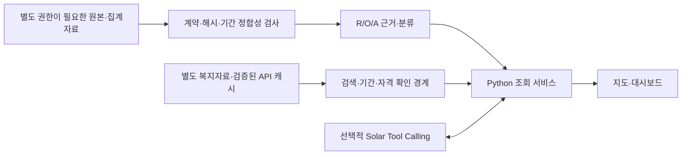

# Team. 삐그덕 — 지역 활동과 복지정보 점검

통신 집계자료의 지역별 변화를 담당자가 근거와 함께 살펴보고, 복지 프로그램의 공개 정보를 조회하는 분석·대시보드·AI Agent 프로젝트입니다. R/O/A는 **지역 단위 점검 신호**이며 개인별 사회적 고립 진단, 고립 확률, 위험 순위, 정책 효과를 뜻하지 않습니다.

2026-10-26 기준 **별도 GCP VM의 보호된 HTTPS 심사 서비스로 배포했습니다.** 노트북과 관리용 SSH 연결 없이 실행되며, 전용 접속 링크는 승인된 경로로 별도 전달합니다. 전체 링크는 인증정보이므로 공개하지 않습니다. [GCP 실행 구조·검증 범위](docs/GCP_RUNTIME.md)와 [제출 기준](docs/SUBMISSION_BASELINE.md)을 확인하세요.

## 분석 구조

| 축 | 의미와 판정 범위 |
|---|---|
| R | 연락 관련 모형 추정 집계 신호. 10~12월 각 기준월의 21동 중앙값을 세 달 모두 엄격히 초과하는지 확인 |
| O | 평일 외출 관련 모형 추정 집계 신호. R과 같은 상대 비교 방식 |
| A | 지역 활동 수준의 두 비교에서 감소 여부 확인. 7\~9월 대비 9\~11월 창과 7월 대비 11월을 사용 |

R/O 네 조합과 A 유무를 결합한 8유형을 제공합니다. 구현 검증 기준은 강남구 22개 동 중 21개 분류, 개포3동 1개 보류입니다. 이 숫자는 실제 고립 진단의 정답률이 아닙니다. R/O와 A는 모집단과 관측 범위가 다르며 같은 개인의 특성 중첩을 가정하지 않습니다. 종합 A는 SK 12월을 포함하지 않으며 연속 감소 판정도 아닙니다.

## AI Agent와 기능

동·기간 선택 → 근거 조회 → R/O/A 판정과 보류 이유 → 복지정보 검색 → 기간·자격·운영 상태의 확인 필요 사항을 안내합니다. 정형 응답을 기본으로 사용하고, 선택한 실제 LLM 모드에서는 Upstage Solar가 허용된 조회 도구를 호출합니다. 최종 응답은 검증된 구조와 조회값에 제한되며 실패하면 정형 응답으로 대체합니다. 자유 서술을 근거 데이터로 채택하지 않습니다.

- 행정동 지도와 기간별 근거, 8유형·보류 표시
- 위치·연령·시간대·요일별 활동 탐색과 기존 완료 캐시 재사용
- 복지정보의 과거 관측/현재 조회 구분, 자격·날짜·출처 주의 표시
- 외부 API 요청 예산과 동시 실행 제한, 실패 시 대체 응답

## 기술과 아키텍처

Python 3.11 이상, pandas/NumPy, GeoPandas/Shapely/pyproj, Folium/Leaflet, Plotly, HTML/JavaScript, Python 표준 HTTP 서버, Upstage의 OpenAI 호환 Tool Calling을 사용합니다. 검증 PC는 Python 3.14.3입니다. Python 3.11 CI는 최소 공개 검증용이며 전체 지리 패키지 환경을 보증하지 않습니다.



## 데이터 없는 환경에서 설치·검증

저장소 루트에서 팀 폴더로 이동한 뒤 실행합니다. 아래 최소 테스트는 Python 표준 라이브러리만 사용하며 외부 키·데이터·네트워크가 필요하지 않습니다.

```powershell
cd BbiGeuDeok
python -B -m unittest discover -s tests -v
```

인공 숫자와 모의 API 응답으로 입력 거부, 엄격한 중앙값 경계, 3개월 판정, 요청 예산, 키 없는 설정과 응답 파서를 검사합니다. 인공 샘플은 실제 행정동 분석값이나 대시보드용 대체 데이터가 아닙니다.

전체 분석 의존성이 필요한 권한 보유자의 설치:

```powershell
python -m venv Code/sk_admin_mapping/.venv
& Code/sk_admin_mapping/.venv/Scripts/python.exe -m pip install -r Code/sk_admin_mapping/requirements.txt
```

실제 자료와 검증된 캐시를 별도로 준비한 뒤 로컬 정형 모드로 실행합니다.

```powershell
& Code/sk_admin_mapping/.venv/Scripts/python.exe -B Code/sk_admin_mapping/run_dashboard.py --structured
```

접속 주소는 `http://127.0.0.1:8766/`입니다. 공개 저장소만 복제하면 실제 지도·분류·검색 서버는 필요한 데이터가 없어 시작되지 않습니다. 제공 데이터와 캐시를 다운로드하는 공개 API는 제공하지 않습니다. [재현성 안내](docs/REPRODUCIBILITY.md)를 먼저 확인하세요.

## 환경변수

실제 값은 서버 환경 또는 저장소 밖 비공개 파일에 주입합니다. 예제 파일은 자동으로 로드되지 않습니다.

| 이름 | 용도 |
|---|---|
| `ROA_ENABLE_LLM` | 실제 LLM 허용, 기본 0. 실행기는 `--structured` 없이 실행하면 1로 설정 |
| `UPSTAGE_API_KEY`, `LLM_ENV_FILE` | 서버 키 또는 비공개 env 경로 |
| `LLM_PROVIDER`, `LLM_MODEL`, `LLM_BASE_URL`, `LLM_ALLOWED_HOSTS` | 공급자·모델·HTTPS 허용 호스트 |
| `LLM_TIMEOUT_SECONDS`, `LLM_MAX_TOKENS` | 질문별 시간·출력 제한 |
| `LLM_MAX_REQUESTS_PER_MINUTE`, `LLM_MAX_REQUESTS_PER_PROCESS` | 프로세스 외부 요청 예산 |
| `SEOUL_OPEN_DATA_API_KEY`, `SEOUL_ENV_FILE` | 관리자 수집용 서울시 인증 |
| `SEOUL_API_BASE_URL` | 확인한 공식 API 주소만 지정 |
| `ROA_USE_WELFARE_API_CACHE` | 검증된 로컬 API 캐시 사용, 실행기는 1로 설정 |

별칭·우선순위·검사 규칙은 `llm_config.py`, `seoul_config.py`가 기준입니다. 로컬 호환 기능으로 사용자 바탕화면의 지정된 env 파일을 찾을 수 있으므로 서버에서는 명시적 설정을 사용합니다. 서울시 평문 HTTP 인증은 기본 차단이며 관리자 CLI의 명시적 예외만 존재합니다. 공개 서버에서는 검증된 HTTPS 갱신 경로를 마련해야 합니다.

## 출처·권리·현재 한계

SK텔레콤·신한카드 대회 자료, 관계망 집계, 서울시 복지자료, 행정경계·주민등록인구를 참조합니다. 원본·집계·파생 결과, 외부 응답과 이미지, 지도 데이터는 이 저장소에 포함하지 않습니다. [데이터·권리 안내](docs/DATA_AND_RIGHTS.md)와 [권리 고지](LICENSE_NOTICE.md)를 확인하세요. 소스에 임의의 오픈소스 라이선스를 부여하지 않았습니다.

R/O 표준화 원분석 생성 코드와 고정 가중치는 확보하지 못했습니다. 공급자의 SK 좌표계와 관계망 산정기간, 개포3동 반복 0값의 원인은 미확인입니다. 복지 목록과 상세의 누락·속성 충돌, 현재 자격·정원·운영 여부도 별도 확인이 필요합니다. 실제 고립 예측 성능과 정책 효과는 검증하지 않았습니다.

[API·구조](docs/API.md) · [배포 사전 점검](docs/DEPLOYMENT_READINESS.md) · [동기화 절차](docs/SYNC.md) · [공개 파일 목록](PUBLIC_FILE_MANIFEST.json)

현재 심사 서비스는 [GCP 실행 구조](docs/GCP_RUNTIME.md)를 따릅니다. 이전 로컬 임시 시연은 [실행 도구](tools/step4/README.md)에 보존합니다. GitHub Actions는 데이터 없는 테스트와 공개 파일 검사를 수행하며 실제 서비스를 호스팅하거나 자동 배포하지 않습니다.

## 화면 구성

Overview · R/O/A 지역 신호 · SK 활동 탐색 · 복지자원 탐색 · AI Agent의 5개 페이지를 제공합니다. 공통 지역 선택은 유지하고 SK 기준월과 ROA 종합기간은 구분합니다. [UI 구조·실행·STEP 4 인계](docs/STEP3_UI.md), [디자인 출처](docs/STEP3_UI_REFERENCES.md)를 확인하세요.
