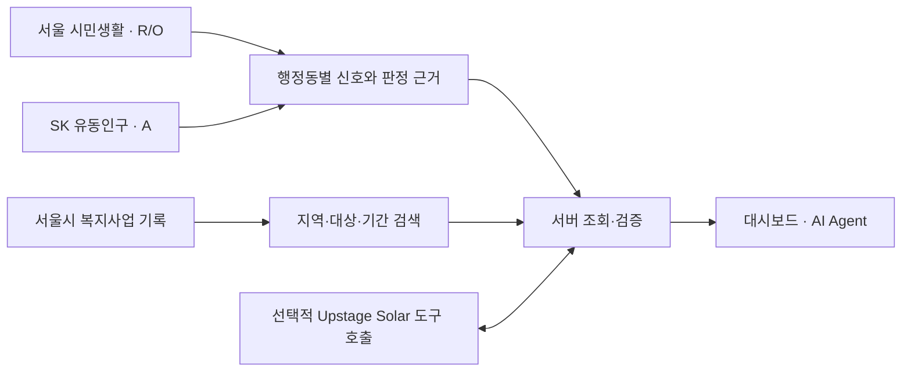

# Team. 삐그덕 | 지역 활동 신호와 복지자원을 연결하는 AI Agent

**2026 빅콘테스트 데이터+AI 혁신 챌린지 출품 · 3인 팀 · 1차 서류 심사 미통과**

어떤 동에서 유동인구가 줄었다면, 복지 담당자는 무엇을 더 확인해야 할까요? 삐그덕은 강남구 행정동별 연락·외출 추정 지표와 유동인구 변화를 함께 보여주고, 담당자가 관측 근거와 복지사업 기록을 한 화면에서 확인할 수 있도록 만든 대시보드입니다. AI Agent는 지역과 검토 시점에 맞춰 근거를 찾고 후속 확인 질문을 정리합니다.

## 담당자가 두 동을 비교하는 방법

아래는 제출 당시 비교 흐름을 보여주는 **가상 행정동 예시**입니다. 담당자가 지도의 유형을 보고 동을 선택한 다음, Agent에 유형의 근거와 당시 복지사업을 묻는 상황입니다.

| 가상 지역 | 연락·평일 외출 신호 | 지역 활동 감소 신호 | Agent가 안내하는 후속 확인 |
| --- | --- | --- | --- |
| A동 | R·O 모두 충족 | 두 감소 조건 모두 충족 | 관계 형성과 복지서비스 접근 수요를 확인하고, 계절·상권·시설 운영 등 지역 활동이 줄었을 수 있는 원인도 살펴봅니다. |
| B동 | R·O 모두 충족 | 두 감소 조건을 모두 충족하지는 않음 | 관계 형성과 서비스 접근 수요를 확인합니다. 활동 변화는 두 비교값을 각각 확인합니다. |

같은 질문에서도 검토 시점에 따라 조회 기준이 달라집니다. 예를 들어 **2025년 당시**를 선택하면 당시 기간과 겹치는 사업 기록을 살펴볼 수 있습니다. 현재 지원을 검토할 때는 공고에 적힌 기간·대상·기관을 확인하고 실제 운영·신청 자격·정원은 담당 기관에 확인할 항목으로 남깁니다. [지역별 후속 질문 규칙](Code/sk_admin_mapping/roa_classification.py) · [복지자원 검색과 기간 판정](Code/sk_admin_mapping/welfare_resources.py)

## 데이터에서 답변까지

| 신호 | 자료 | 판정 기준 |
| --- | --- | --- |
| R · 연락 | 서울 시민생활의 거주 추정 1인 가구 지표 | 2025년 10월, 11월, 12월 각각의 21개 비교 가능 동 중앙값을 세 달 모두 초과하면 충족 |
| O · 평일 외출 | 서울 시민생활의 거주 추정 1인 가구 지표 | 평일 외출 관련 지표에 R과 같은 월별 상대 기준을 적용 |
| A · 지역 활동 감소 | 방문자를 포함하는 SK텔레콤 유동인구 집계 | 2025년 7–9월 대비 9–11월과 7월 대비 11월, 두 비교에서 모두 감소하면 충족 |

R과 O의 네 가지 조합에 A의 충족 여부를 붙여 8개 유형을 만듭니다. 강남구 22개 동 중 21개 동을 분류했고, 반복 0값의 원인을 확인하지 못한 한 동은 분류를 보류했습니다. 각 유형은 행정동별로 어떤 근거와 질문을 먼저 살펴볼지 표시합니다. [판정 코드](Code/sk_admin_mapping/roa_classification.py) · [제출 기준과 검증 범위](docs/SUBMISSION_BASELINE.md)



기본 모드는 서버가 조회 결과를 정형 응답으로 구성합니다. Upstage Solar 모드에서는 모델이 허용된 조회 도구를 호출하고 사용할 근거와 확인 질문을 선택합니다. 서버가 그 선택을 검증한 뒤 수치·사업명·날짜를 조회값으로 구성하며, 호출 또는 검증에 실패하면 정형 응답으로 전환합니다. [Agent 구현](Code/sk_admin_mapping/roa_agent.py) · [서버 API](docs/API.md) · [대시보드 구조](docs/STEP3_UI.md)

## 팀원별 기여

| 팀원 | 담당 |
| --- | --- |
| 정창의 | SK 유동인구의 위치·연령·시간대·요일별 변화 분석, 대시보드와 AI Agent 개발, 서울시 복지 API 인증키 발급 및 조회 연동 |
| 홍은진 | 서울 시민생활 데이터 발굴·분석, 연락·평일 외출 지표 제안 |
| 문지민 | 복지자원 데이터 발굴·확보 |
| 팀 공동 | 행정동 단위에서 두 분석을 결합하는 기준 결정 |

[SK 활동 분석](Code/sk_admin_mapping/activity_analysis.py) · [서울시 복지 API 연동](Code/sk_admin_mapping/welfare_api.py) · [대시보드 진입점](Code/sk_admin_mapping/run_dashboard.py)

## 제출 결과와 한계

SK 자료로 강남과 춘천의 유동인구 변화를 탐색했습니다. 유동인구 자료만으로는 대회 주제인 사회적 고립을 정의할 근거가 부족했습니다. 서울 시민생활 지표를 추가한 뒤 최종 R/O/A 분석과 Agent 시연은 강남구에 집중했고, 춘천의 활동 결과는 같은 방식의 종합 분석으로 이어지지 못했습니다. 개인의 고립 여부를 검증할 정답 데이터, 실제 담당자 활용 검증, 정책 효과 검증은 확보하지 못했습니다.

2026년 10월 제출 당시 지도와 활동 탐색, 복지자원 검색, AI Agent를 보호된 GCP 심사 환경에 배포했습니다. 배포 구성과 당시 확인한 범위는 기술 문서에 기록했습니다. [GCP 배포 기록](docs/GCP_RUNTIME.md) · [이전 로컬 시연](docs/STEP4A_DEMO.md)

## 공개 코드 확인하기

Python 3.11 이상에서 저장소 루트 기준으로 실행합니다. 아래 테스트는 표준 라이브러리와 인공 입력을 사용해 분류 경계, 응답 처리, API 요청 제한 등을 확인합니다.

```powershell
cd BbiGeuDeok
python -B -m unittest discover -s tests -v
```

전체 서비스 실행에는 별도 권한이 필요한 대회 자료와 검증된 캐시가 필요합니다. 공개 저장소에는 코드, 설정 예시, 인공 테스트가 있습니다. [재현 범위](docs/REPRODUCIBILITY.md) · [데이터 출처 및 권리](docs/DATA_AND_RIGHTS.md) · [권리 고지](LICENSE_NOTICE.md)

<details>
<summary>실행 환경과 운영 문서</summary>

분석에는 pandas·NumPy와 GeoPandas·Shapely·pyproj를, 지도와 화면에는 Folium·Leaflet, Plotly, HTML/CSS/JavaScript를 사용했습니다. 서버는 Python 표준 HTTP 서버를 사용합니다.

권한이 있는 환경에서 자료와 캐시를 준비한 뒤 팀 폴더에서 실행합니다.

```powershell
python -m venv Code/sk_admin_mapping/.venv
& Code/sk_admin_mapping/.venv/Scripts/python.exe -m pip install -r Code/sk_admin_mapping/requirements.txt
& Code/sk_admin_mapping/.venv/Scripts/python.exe -B Code/sk_admin_mapping/run_dashboard.py --structured
```

정형 모드 접속 주소는 `http://127.0.0.1:8766/`입니다. 실제 API 설정값은 서버 환경이나 저장소 밖의 비공개 파일로 주입합니다. 전체 의존성과 실행 조건은 재현 문서에서 확인할 수 있습니다.

[LLM 환경변수 예시](Code/sk_admin_mapping/llm.env.example) · [서울시 API 환경변수 예시](Code/sk_admin_mapping/seoul.env.example) · [공개본 동기화](docs/SYNC.md) · [공개 파일 목록](PUBLIC_FILE_MANIFEST.json)

</details>
